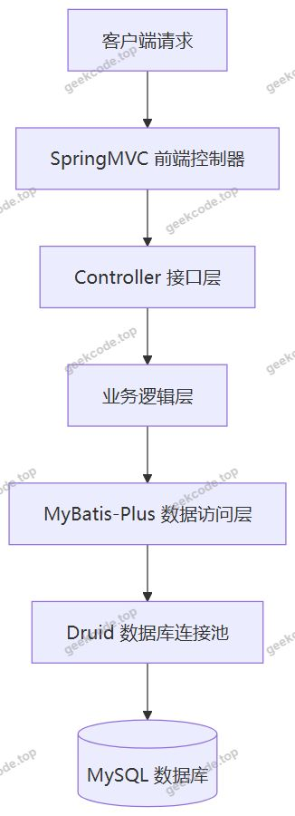
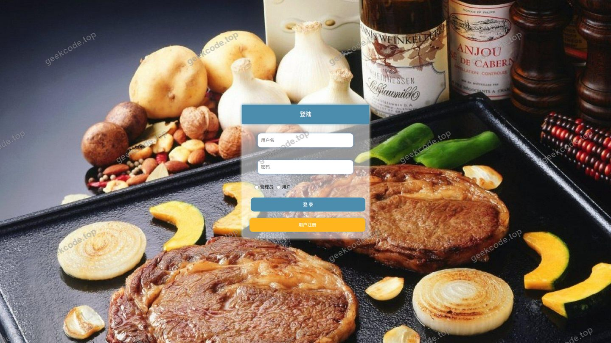
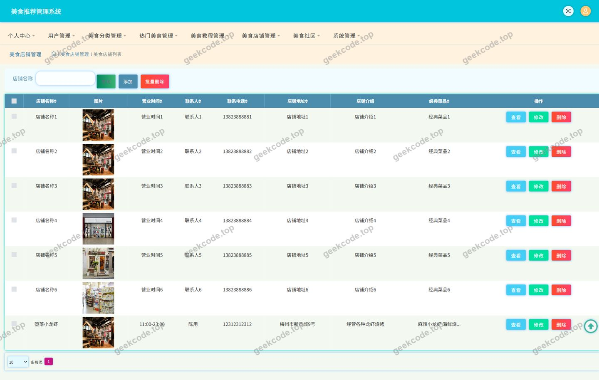
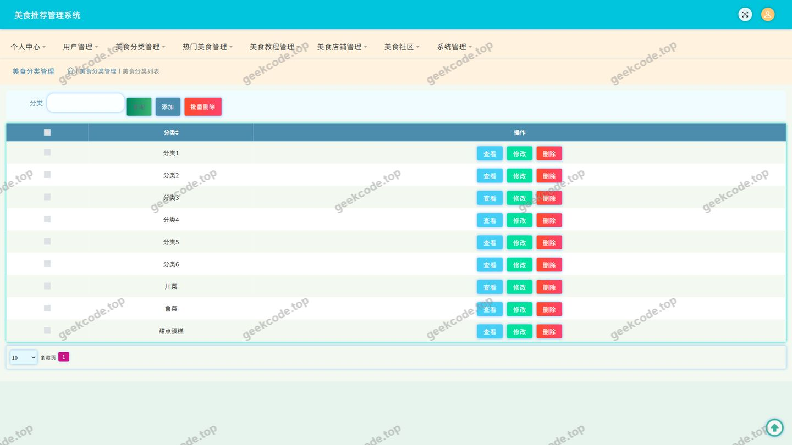
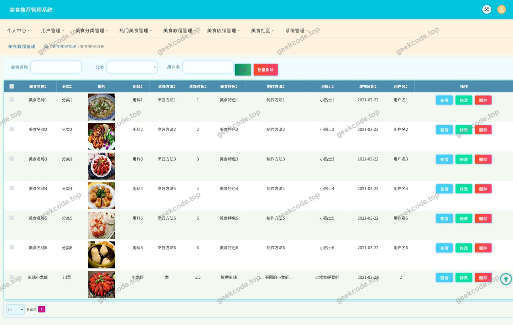
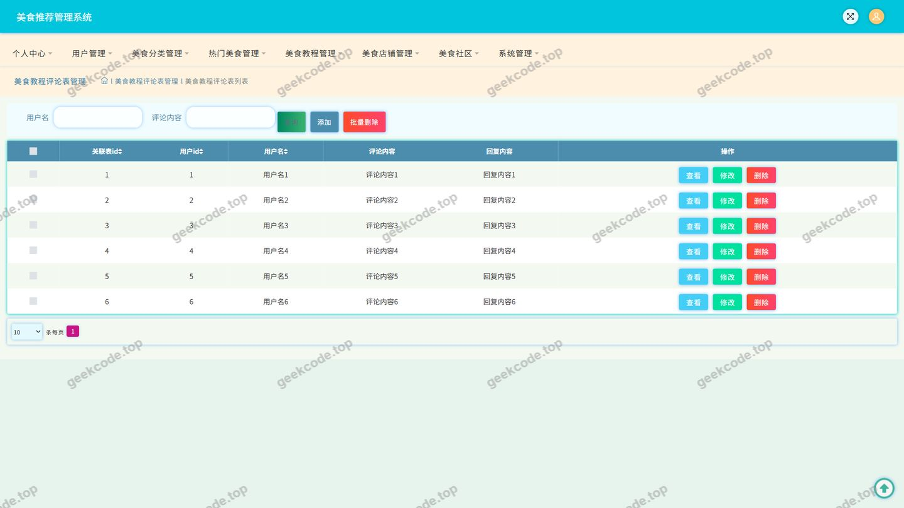
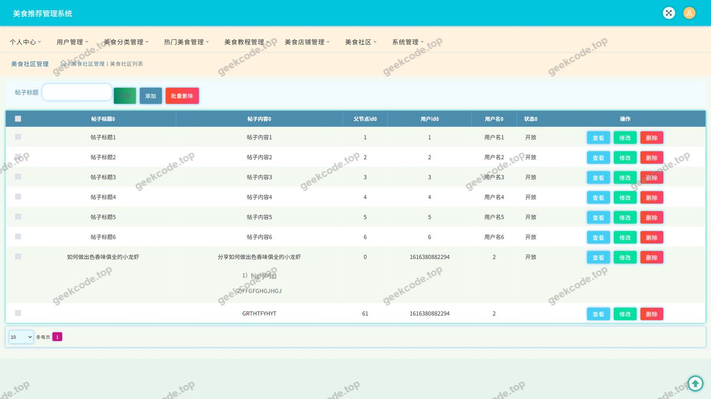
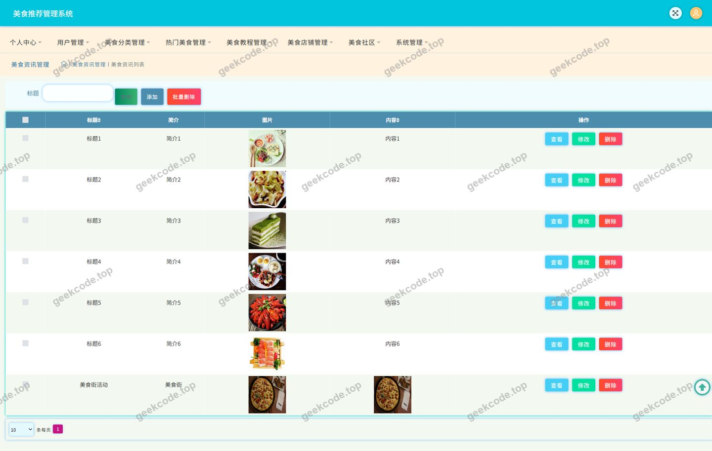
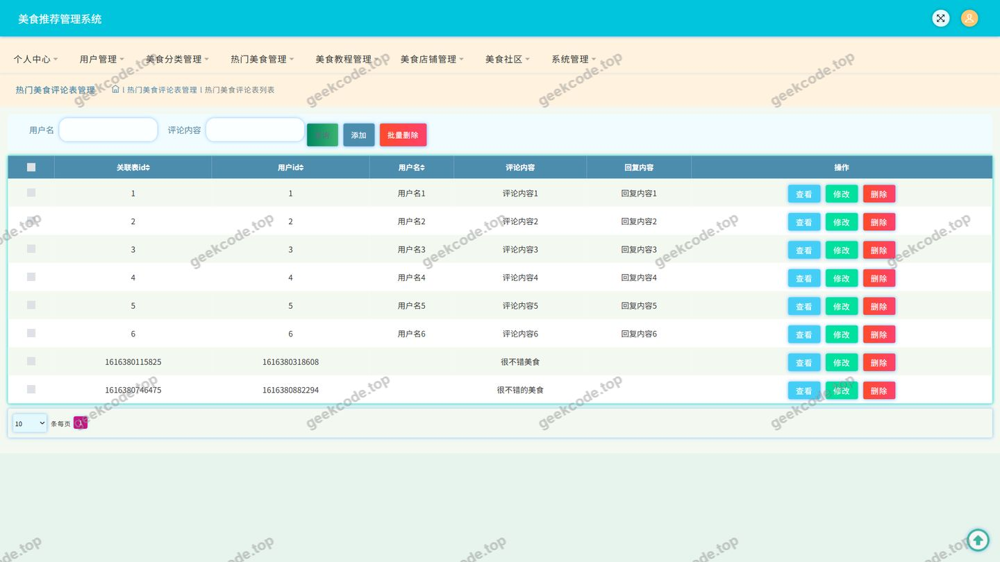
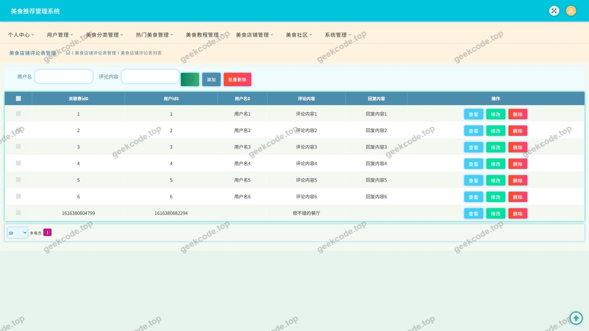

# java项目-ssm美食推荐管理系统-带论文

> 🎓 **计算机毕业设计 · java项目-ssm美食推荐管理系统-带论文**
>
> 本仓库只放**项目介绍 + 运行截图**（截图是站点带水印的原图，存在仓库 `images/` 里）。
>
> 👉 **完整可运行源码 / 数据库脚本 / 部署文档：[点我获取](https://geekcode.top/archives/java%E9%A1%B9%E7%9B%AE-ssm%E7%BE%8E%E9%A3%9F%E6%8E%A8%E8%8D%90%E7%AE%A1%E7%90%86%E7%B3%BB%E7%BB%9F-%E5%B8%A6%E8%AE%BA%E6%96%87?utm_source=github)**
>
> 💬 咨询微信：**ir9372**　|　🌐 更多项目：[极客代码 geekcode.top](https://geekcode.top/?utm_source=github)
>
> 📌 项目详情页：<https://geekcode.top/archives/java%E9%A1%B9%E7%9B%AE-ssm%E7%BE%8E%E9%A3%9F%E6%8E%A8%E8%8D%90%E7%AE%A1%E7%90%86%E7%B3%BB%E7%BB%9F-%E5%B8%A6%E8%AE%BA%E6%96%87?utm_source=github>

<table><td width="230" align="center"> <b>扫码加微信 ir9372</b></td><td valign="middle">📦 源码 = 项目介绍 + 全部运行截图 + 数据库 + 部署文档 👉 点上方任意截图，直接跳到 <b>极客代码 geekcode.top</b> 详情页</td></table>

---

<h1>java项目-ssm美食推荐管理系统-带论文</h1>
<h2>项目概述</h2>

本项目名为“java项目-ssm美食推荐管理系统-带论文”，是一套面向美食领域的推荐与内容管理平台。系统以美食内容为核心，围绕热门美食、美食教程、美食店铺、美食社区、美食资讯五大板块构建业务闭环，同时提供评论互动、内容收藏、个人发布等用户能力。

系统核心功能包括：热门美食与美食教程的浏览与评论、美食店铺与美食分类的展示、美食社区的帖子发布与交流、美食资讯的阅读，以及个人中心下的“我的发布”“我的收藏”等个性化管理能力；同时提供用户信息维护、文件上传与系统配置读取等基础服务接口。

适用人群为美食爱好者、内容创作者及平台运营管理者。技术架构采用 Spring + SpringMVC + MyBatis-Plus 的经典分层架构，数据访问层通过 MyBatis-Plus 实现，数据库连接由 Druid 连接池统一管理，各业务模块以 Controller 为对外接口单元，对外提供纯 API 服务。项目类型为 pure-api，即后端服务工程，未包含前台路由与后台路由配置。

<h2>技术架构</h2>
<h3>整体架构</h3>

系统采用经典的 SSM 分层架构，后端为纯 API 服务形态。请求经 SpringMVC 前端控制器分发至各业务 Controller，Controller 调用业务逻辑后通过 MyBatis-Plus 完成持久化操作，数据库连接由 Druid 连接池统一提供并管理。

<h3>技术选型理由</h3>
<table>
<thead>
<tr>
<th>技术组件</th>
<th>作用</th>
<th>选型理由</th>
</tr>
</thead>
<tbody><tr>
<td>spring-core / spring-beans / spring-context</td>
<td>IOC 容器与依赖注入</td>
<td>统一管理对象生命周期，降低模块耦合</td>
</tr>
<tr>
<td>spring-web / spring-webmvc</td>
<td>Web 层请求分发与参数绑定</td>
<td>提供注解式 Controller，接口开发简洁直观</td>
</tr>
<tr>
<td>spring-aop</td>
<td>面向切面编程</td>
<td>支持日志、事务等横切逻辑的统一织入</td>
</tr>
<tr>
<td>spring-tx</td>
<td>声明式事务管理</td>
<td>保证评论、发布、收藏等写操作的数据一致性</td>
</tr>
<tr>
<td>spring-jdbc</td>
<td>JDBC 抽象</td>
<td>与数据源、事务管理协同工作</td>
</tr>
<tr>
<td>MyBatis-Plus</td>
<td>持久层框架</td>
<td>提供通用 CRUD 与条件构造能力，减少样板代码</td>
</tr>
<tr>
<td>Druid</td>
<td>数据库连接池</td>
<td>连接复用，提升数据库访问效率并支持连接监控</td>
</tr>
<tr>
<td>junit</td>
<td>单元测试</td>
<td>支撑业务逻辑与接口的基础测试</td>
</tr>
</tbody></table>
<h3>数据库设计要点</h3>

根据代码上下文中的业务实体与控制器划分，系统数据模型可归纳为以下几类实体：

<ul>
<li>用户实体：由用户管理页面与个人中心功能支撑，用于承载账号信息。</li>
<li>内容实体：热门美食、美食教程、美食店铺、美食资讯，分别对应独立的数据表与管理接口。</li>
<li>分类实体：美食分类，为美食内容提供归类维度。</li>
<li>互动实体：美食社区（论坛帖子），以及热门美食评论、美食教程评论、美食店铺评论三类评论数据。</li>
<li>收藏实体：支撑个人中心“我的收藏”功能。</li>
</ul>

各实体具体的字段结构、索引与约束设计，根据现有信息无法确定。

<h3>接口组织方式</h3>

控制器按业务域拆分，职责划分如下：

<ul>
<li>CommonController：承载系统通用性接口。</li>
<li>ConfigController：承载配置读取相关接口。</li>
<li>FileController：承载文件上传与访问相关接口。</li>
<li>ForumController：承载美食社区业务接口。</li>
<li>MeishidianpuController：承载美食店铺业务接口。</li>
<li>MeishifenleiController：承载美食分类业务接口。</li>
<li>MeishijiaochengController：承载美食教程业务接口。</li>
<li>NewsController：承载美食资讯业务接口。</li>
<li>RemenmeishiController：承载热门美食业务接口。</li>
<li>DiscussmeishidianpuController：承载美食店铺评论接口。</li>
<li>DiscussmeishijiaochengController：承载美食教程评论接口。</li>
<li>DiscussremenmeishiController：承载热门美食评论接口。</li>
</ul>
<h2>功能模块</h2>
<h3>前台用户端</h3>
<ul>
<li>登录模块：提供用户登录入口，是进入系统各功能页面的前置环节。</li>
<li>用户模块：承载用户账号信息的展示与维护。</li>
<li>热门美食模块：展示热门美食内容，并支持用户对热门美食发表评论。</li>
<li>美食教程模块：展示美食教程内容，并支持用户对美食教程发表评论。</li>
<li>美食店铺模块：按分类展示美食店铺信息，评论能力由对应评论控制器承载。</li>
<li>美食分类模块：为美食内容提供分类浏览维度。</li>
<li>美食社区模块：以论坛形式承载用户之间的美食话题发布与交流。</li>
<li>美食资讯模块：展示美食相关资讯内容。</li>
<li>个人中心模块：提供个人中心入口。</li>
<li>我的发布模块：集中管理当前用户已发布的内容。</li>
<li>我的收藏模块：集中管理当前用户已收藏的内容。</li>
<li>文件模块：通过 FileController 提供文件上传与访问能力，用于内容配图等场景。</li>
</ul>
<h3>后台管理端</h3>

根据现有代码上下文，系统未配置后台路由信息，因此后台管理端的页面级路由与菜单结构无法确定。从控制器构成看，热门美食、美食教程、美食店铺、美食分类、美食资讯、美食社区、用户、评论、文件与配置等业务均已具备独立的服务端接口，具备支撑内容管理的能力。

<h2>用户角色与权限</h2>

系统包含以下两类角色：

<h3>普通用户</h3>
<ul>
<li>登录：通过登录页面完成身份认证后进入系统。</li>
<li>个人中心：查看与维护个人账号信息。</li>
<li>热门美食：浏览热门美食内容，发表评论。</li>
<li>美食教程：浏览美食教程内容，发表评论。</li>
<li>美食店铺：浏览美食店铺内容。</li>
<li>美食分类：按分类浏览美食内容。</li>
<li>美食社区：浏览社区内容，发布帖子参与交流。</li>
<li>美食资讯：浏览美食资讯内容。</li>
<li>我的发布：查看与管理自己已发布的内容。</li>
<li>我的收藏：查看与管理自己收藏的内容。</li>
<li>文件上传：通过文件接口上传内容配图等资源。</li>
</ul>
<h3>管理员</h3>
<ul>
<li>用户管理：通过用户管理页面对平台用户账号进行维护。</li>
<li>热门美食管理：对热门美食内容进行维护。</li>
<li>美食教程管理：对美食教程内容进行维护。</li>
<li>美食店铺管理：对美食店铺内容进行维护。</li>
<li>美食分类管理：对美食分类进行维护。</li>
<li>美食资讯管理：对美食资讯内容进行维护。</li>
<li>美食社区管理：对社区帖子内容进行维护。</li>
<li>评论管理：对热门美食评论、美食教程评论、美食店铺评论进行维护。</li>
<li>文件与配置管理：通过文件接口与配置接口完成资源与参数维护。</li>
</ul>

两个角色在接口层面的具体权限校验范围与粒度，根据现有信息无法确定。

<h2>项目特色与创新点</h2>
<ul>
<li>内容与互动一体化的美食业务闭环：系统将热门美食、美食教程、美食店铺、美食社区、美食资讯五类内容整合于同一平台，并针对热门美食、美食教程、美食店铺分别设计独立的评论接口，形成“浏览—互动—沉淀”的完整链路。</li>
<li>分层清晰的纯 API 架构：后端按 Controller 粒度对业务域进行拆分，评论类业务独立成控制器，与主内容控制器解耦，便于接口维护与扩展。</li>
<li>MyBatis-Plus 与 Druid 组合的数据访问方案：借助 MyBatis-Plus 的通用数据访问能力降低持久层样板代码量，同时通过 Druid 连接池提升数据库访问性能与管理能力。</li>
<li>个人内容资产化管理：通过“我的发布”与“我的收藏”两个入口，将用户产生的内容与收藏行为集中归档，提升用户对自身数据的掌控感。</li>
<li>分类驱动的美食内容组织方式：以美食分类作为内容组织维度，使热门美食、美食教程、美食店铺等内容具备统一的检索与归类基础。</li>
</ul>
<h2>部署环境</h2>
<h3>软件环境</h3>
<table>
<thead>
<tr>
<th>类别</th>
<th>要求</th>
</tr>
</thead>
<tbody><tr>
<td>开发语言</td>
<td>Java</td>
</tr>
<tr>
<td>JDK 版本</td>
<td>根据现有信息无法确定具体版本</td>
</tr>
<tr>
<td>构建工具</td>
<td>Maven（依赖坐标由 spring-*、MyBatis-Plus、Druid、junit 等构件组成）</td>
</tr>
<tr>
<td>Web 容器</td>
<td>需支持 Servlet 规范的容器（技术依赖中包含 spring-web 与 spring-webmvc）</td>
</tr>
<tr>
<td>数据库</td>
<td>MySQL（数据访问由 spring-jdbc 与 MyBatis-Plus 配合 Druid 连接池完成）</td>
</tr>
<tr>
<td>数据库连接池</td>
<td>Druid</td>
</tr>
<tr>
<td>持久层框架</td>
<td>MyBatis-Plus</td>
</tr>
<tr>
<td>应用框架</td>
<td>Spring、SpringMVC</td>
</tr>
<tr>
<td>测试框架</td>
<td>JUnit</td>
</tr>
<tr>
<td>客户端</td>
<td>支持 HTTP 请求的浏览器或接口调试工具</td>
</tr>
</tbody></table>
<h3>部署说明</h3>
<ul>
<li>项目类型为 pure-api，部署后以接口服务形式对外提供能力。</li>
<li>系统未提供前台路由与后台路由配置，因此不涉及前端工程的路由部署；项目相关的前端页面工程信息，根据现有信息无法确定。</li>
<li>未使用 Node.js，也无微信开发者工具相关依赖。</li>
</ul>
<h2>五、技术特性</h2>
<ul>
<li>使用 MyBatis-Plus 简化数据访问层开发</li>
</ul>
<h2>六、功能模块截图</h2>
<h3>后台管理端</h3>
<h4>页面-登录</h4>

<h4>页面-美食店铺</h4>

<h4>页面-美食分类</h4>

<h4>页面-美食教程</h4>

<h4>页面-美食教程评论</h4>

<h4>页面-美食社区</h4>

<h4>页面-美食资讯</h4>

<h4>页面-热门美食评论</h4>

<h4>页面-用户</h4>

---

## 获取完整源码

| 项目 | 说明 |
| --- | --- |
| 项目名 | java项目-ssm美食推荐管理系统-带论文 |
| 运行截图 | 本文 10 张（站点带水印原图，仓库 `images/` 目录） |
| 完整源码 | [https://geekcode.top/archives/java%E9%A1%B9%E7%9B%AE-ssm%E7%BE%8E%E9%A3%9F%E6%8E%A8%E8%8D%90%E7%AE%A1%E7%90%86%E7%B3%BB%E7%BB%9F-%E5%B8%A6%E8%AE%BA%E6%96%87?utm_source=github](https://geekcode.top/archives/java%E9%A1%B9%E7%9B%AE-ssm%E7%BE%8E%E9%A3%9F%E6%8E%A8%E8%8D%90%E7%AE%A1%E7%90%86%E7%B3%BB%E7%BB%9F-%E5%B8%A6%E8%AE%BA%E6%96%87?utm_source=github) |
| 咨询微信 | **ir9372**（备注：jingpin-yuanma） |
| 更多项目 | [极客代码 geekcode.top](https://geekcode.top/?utm_source=github) |

> 需要源码、部署、改配置、跑不起来等问题，加微信 ir9372 沟通，说明项目名即可。
